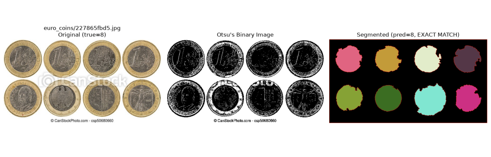
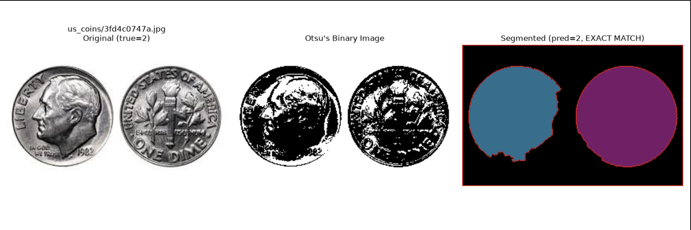
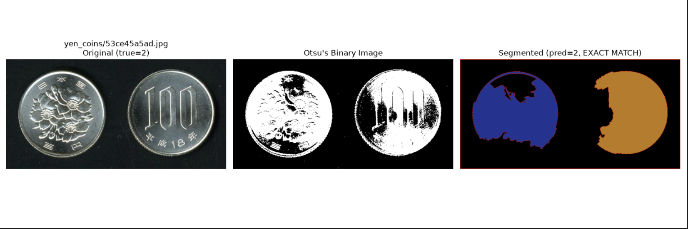
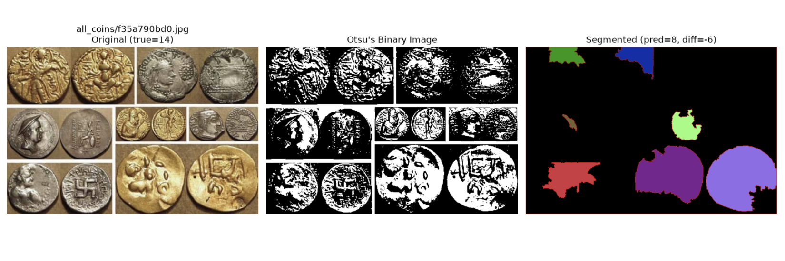
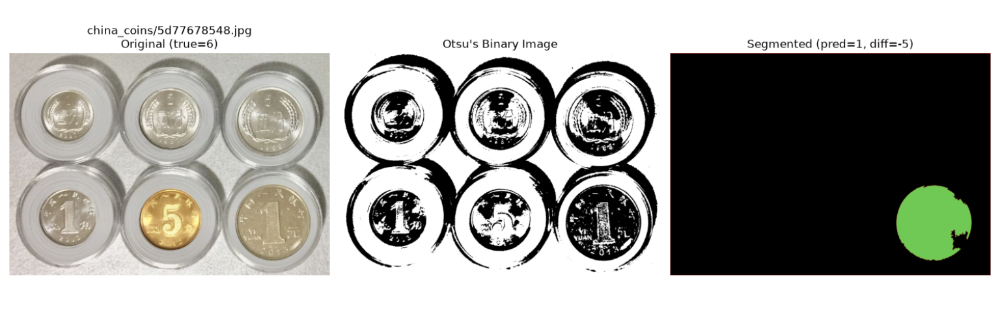
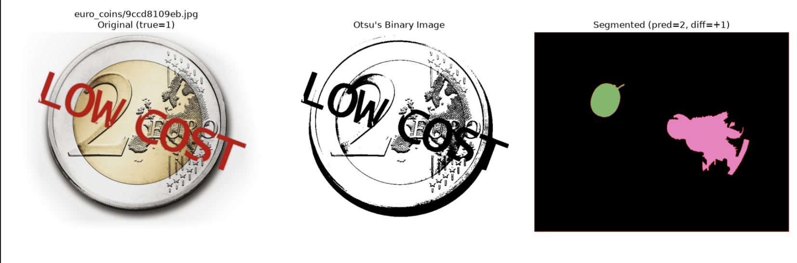

# Classical Computer Vision — Weeks 1–5

This repo covers Weeks 1-5 of the Computer Vision & Object
Detection. Each week is a self-contained mini-project built on plain NumPy + OpenCV, moving from manual pixel-level algorithm
implementations (Week 1–2) toward using OpenCV's built-in primitives as
building blocks for larger pipelines (Week 3–5).

| Week | Topic | Assignment | Core Files |
|---|---|---|---|
| 1 | Color/Histogram Math | Manual Histogram Optimizer (CLAHE) | `manual-clahe.py` |
| 2 | Spatial Filtering | Noise Suppression Pipeline | `image-denoiser.py`, `gaussian.py` |
| 3 | Geometric Warping | Document Rectification | `main.py`, `detection.py`, `gaussian.py`, `warp.py` |
| 4 | Edge/Hough Transforms | Industrial Feature Extractor | `main.py`, `hough_circles.py` |
| 5 | Segmentation | Overlapping Object Counter | `main.py`, `otsu.py`, `watershed.py`, `eval_coin_counter.py` |

## Suggested Folder Layout

Because Weeks 3, 4, and 5 each ship their own `main.py`, keep every week in
its own folder so the scripts and their expected image folders don't
collide:

```
week1_histogram_optimizer/
    manual-clahe.py
    low-light-images/        <- put input .jpg/.png files here

week2_noise_suppression/
    image-denoiser.py
    noisy-images/

week3_document_rectification/
    main.py
    detection.py
    gaussian.py
    warp.py
    images/

week4_feature_extractor/
    main.py
    hough_circles.py
    circle-detection-images/

week5_object_counter/
    main.py
    otsu.py
    watershed.py
    eval_coin_counter.py
    coin-counting-eval/      <- Kaggle dataset (required for evaluation)
        coins_count_values.csv
        coins_images/
            all_coins/
            china_coins/
            euro_coins/
            indian_coins/
            peso_coins/
            us_coins/
            yen_coins/
    random_predictions/      <- figures saved by eval_coin_counter.py
    assets/                      <- static images for README
       week5_exact_euro_coins.png
       week5_exact_us_coins.png
       week5_exact_yen_coins.png
       week5_fail_all_coins.png
       week5_fail_china_coins.png
       week5_fail_euro_coins.png
```

## Requirements

```
pip install opencv-python numpy matplotlib
```

All scripts are run directly with `python <script>.py` from inside their
week's folder (they locate their input folder relative to `__file__`, so
the working directory doesn't matter as much as the script's own location).
Each script loops over every file in its input folder, processes it, and
pops up a `matplotlib` window comparing original vs. result. Close a
window to move on to the next image.

---

## Week 1 — Manual Histogram Optimizer (CLAHE)

**File:** `manual-clahe.py`

### What it does
Implements Contrast Limited Adaptive Histogram Equalization (CLAHE) from
scratch using only NumPy — no `cv.createCLAHE()`. CLAHE fixes uneven,
low-light exposure by equalizing contrast *locally* (per image tile)
instead of globally, which brings out detail in both dark and bright
regions of the same image without blowing out highlights.

### How it works
1. **`clipped_histogram`** — builds a 256-bin histogram for one tile,
   clips any bin above `clip_limit_pixels`, and redistributes the
   clipped-off pixel count evenly across all bins. This is the "contrast
   limited" part — it stops flat regions (e.g. sky, wall) from getting
   wildly over-amplified, which is the classic failure mode of plain
   Adaptive Histogram Equalization.
2. **`histogram_to_lut`** — turns that clipped histogram into a 256-value
   lookup table via its cumulative distribution function (standard
   histogram-equalization math), rescaled to span the full `0–255` range.
3. **`manual_clahe`** —
   - Pads the image (edge-replication) so it divides evenly into an
     `8×8` grid of tiles by default.
   - Computes one LUT per tile.
   - **Bilinearly interpolates between the 4 nearest tile LUTs** for every
     pixel, using its distance from each tile center as blend weight.
     This is what removes visible blocky seams at tile boundaries and is
     the part that makes CLAHE "adaptive" rather than just "tiled
     equalization."
   - Crops back to the original size and returns a `uint8` image.

### How to run
1. Create a `low-light-images/` folder next to `manual-clahe.py`.
2. Drop in grayscale-convertible images (any `.jpg`/`.png`).
3. Run:
   ```bash
   python manual-clahe.py
   ```
4. For each image, a side-by-side window opens: original vs. manual CLAHE
   result (`clip_limit=3.0`, `tile_grid_size=(8, 8)` by default — tune
   these inside `main()`).

---

## Week 2 — Noise Suppression Pipeline

**Files:** `image-denoiser.py` (self-contained version used by the
`main()` in this file), plus `gaussian.py` (a cleaner, reusable Gaussian
blur module used later in Week 3).

### What it does
Automatically detects *which kind* of noise is present in an image —
salt-and-pepper vs. Gaussian — and applies whichever filter is
mathematically the better fit, rather than always using one filter type.

### How it works
1. **`classify_noise`** — counts how many pixels sit at the extreme
   values (`0` or `255`). Salt-and-pepper noise slams pixels to these
   extremes, so if more than 2% of pixels are pure black/white, the image
   is classified `salt_and_pepper`; otherwise `gaussian`.
2. **`apply_median_blur`** (for salt-and-pepper) — a hand-rolled median
   filter: pads the image, slides a `k×k` window over every pixel, and
   replaces it with the neighborhood median. Median filters are
   non-linear and excellent at salt-and-pepper because they ignore
   outlier extreme values rather than averaging them in.
3. **`build_gaussian_kernel` / `apply_gaussian_blur`** (for Gaussian
   noise) — builds a normalized 2D Gaussian kernel by hand and convolves
   it with the image via a padded sliding window. Gaussian blur is the
   linear, mathematically-optimal filter for zero-mean Gaussian noise.
4. **`pipeline`** — orchestrates the above: converts to grayscale only to
   *classify* the noise, then applies the chosen filter independently to
   each of the B/G/R channels of the original color image and re-merges
   them.

### `gaussian.py` (used again in Week 3)
A tidier, standalone version of the Gaussian blur logic
(`pad_image`, `build_gaussian_kernel`, `apply_gaussian_blur`) that works
directly on multi-channel BGR images in one pass (loops over channels
internally) rather than needing the caller to split channels first.

### How to run
1. Create a `noisy-images/` folder next to `image-denoiser.py`.
2. Run:
   ```bash
   python image-denoiser.py
   ```
3. Console output tells you which noise type was detected per file; a
   matplotlib window shows original vs. denoised result.

> **Note:** the manual median/Gaussian loops are pure Python `for y / for
> x` pixel loops, so they're intentionally educational rather than fast —
> expect them to be noticeably slower than `cv.medianBlur` /
> `cv.GaussianBlur` on large images.

---

## Week 3 — Document Rectification

**Files:** `main.py`, `detection.py`, `gaussian.py`, `warp.py`

### What it does
Given a photo of a document (ID card, license plate, etc.) taken at an
angle, this pipeline finds its 4 corners and warps it into a flat,
top-down rectangle — like a mini document scanner.

### How it works (pipeline order, per `main.py`)
1. **Denoise** — `apply_gaussian_blur` (from `gaussian.py`) smooths the
   image slightly so Canny edge detection isn't overwhelmed by texture
   noise.
2. **`detect_document_corners`** (`detection.py`):
   - Runs `cv.Canny` to get a binary edge map.
   - **Closes** small gaps in the edges (`dilate` then `erode`) so the
     document's outline becomes one continuous, traceable contour instead
     of broken fragments.
   - Finds external contours, keeps the 10 largest by area (cheap
     pre-filter), and for each one approximates it to a simplified
     polygon with `cv.approxPolyDP`.
   - Keeps the largest polygon that has **exactly 4 vertices** and passes
     a minimum-area threshold — that's the document boundary.
3. **`rectify`** (`warp.py`) — the geometric core:
   - **`order_points`** — sorts the 4 unordered corners into
     top-left/top-right/bottom-right/bottom-left using the
     `x+y` (min/max) and `y-x` (min/max) trick.
   - Computes output width/height from the actual max side lengths of the
     detected quad (so perspective distortion doesn't squash the result).
   - **`compute_homography`** — solves the 8×8 linear system by hand
     (via `np.linalg.inv`) for the homography matrix mapping the skewed
     source corners to a flat destination rectangle.
   - **`inverse_warp`** — for every *output* pixel, maps it back into the
     *source* image using `H⁻¹`, then samples the source at that
     (generally non-integer) location with **`linear_interpolate`**
     (manual bilinear interpolation) to avoid aliasing/blockiness.
4. `main.py` visualizes 3 panels per image: original, detected corners
   outlined in green, and the final rectified crop.

### How to run
1. Create an `images/` folder next to `main.py` with photos of documents.
2. Run:
   ```bash
   python main.py
   ```
3. If no 4-point contour is found for an image, it's skipped gracefully
   (a small black placeholder is shown instead of crashing the batch).

---

## Week 4 — Industrial Feature Extractor (Hough Circles)

**Files:** `main.py`, `hough_circles.py`

### What it does
Detects circular mechanical parts (e.g. bolts, washers, gears) in a
top-down factory-line image using the Hough Circle Transform, draws each
detected circle with its center, and labels it with its measured
diameter in pixels.

### How it works
1. **`detect_circles`** — grayscales and median-blurs the image (removes
   small speckle noise that would otherwise create false circle votes),
   then calls `cv.HoughCircles` with:
   - `minDist` scaled to image height (`/30`) so genuinely close, distinct
     parts aren't merged into one detection.
   - `param1=200` (the internal Canny high threshold used by the Hough
     accumulator) and `param2=22` (accumulator vote threshold — lower
     means more, possibly noisier, detections).
   - `minRadius=5, maxRadius=30` to constrain the expected part size.
2. **`draw_circles`** — for each detected `(x, y, radius)`, draws the
   circle outline (red), a filled center dot (green), and overlays a
   `D = <diameter>` text label. Raises a clear error if nothing was
   found rather than silently returning an unmodified image.
3. **`hough_circles`** ties the two together and is the single function
   `main.py` calls per image.

### How to run
1. Create a `circle-detection-images/` folder next to `main.py`.
2. Run:
   ```bash
   python main.py
   ```
3. Each image pops up as a 2-panel comparison: original vs. detected
   circles with diameters labeled. Per-image errors (e.g. "no circles
   detected") are caught and printed without stopping the batch.

> **Tuning tip:** `param2` is the most sensitive knob — lower it to catch
> faint/low-contrast circles (at the risk of false positives), raise it
> for stricter, cleaner detections.

---

## Week 5 — Overlapping Object Counter (Otsu + Watershed)

**Files:** `main.py`, `otsu.py`, `watershed.py`, `eval_coin_counter.py`

### What it does
Counts objects (e.g. coins) in an image even when several of them are
touching or overlapping — a case where a naive threshold + connected
components would merge touching objects into a single blob and
undercount. The updated implementation also normalizes Otsu polarity
before segmentation, so dark coins on bright backgrounds are handled
correctly instead of being mistaken for background.

### How it works
1. **`otsu_threshold`** (`otsu.py`) — implements Otsu’s method by hand:
   - Builds a normalized 256-bin histogram (probability per intensity).
   - Computes cumulative pixel-fraction (`omega`) and cumulative mean
     (`mu`) arrays.
   - For every possible threshold `t`, computes the **between-class
     variance** in closed form; the threshold that *maximizes* it best
     separates foreground from background.
   - Returns both the optimal threshold and the resulting binary image.

2. **`watershed`** (`watershed.py`) — updated segmentation core:
   - Converts to grayscale and applies a small Gaussian blur `(5,5)`.
   - Runs `cv.bilateralFilter` twice (`sigmaColor=60`, `sigmaSpace=15`).
     This smooths flat regions while preserving coin edges, which helps
     Otsu and distance-transform seeding.
   - Runs `otsu_threshold` to get a binary mask.
   - Calls **`fix_polarity`** on the binary mask. It samples the image
     border: if more than 50% of border pixels are `255`, the mask is
     assumed inverted (background is bright) and `cv.bitwise_not` is
     applied. This ensures `255` consistently means “object/coin” for the
     rest of the pipeline.
   - **Morphological opening then closing** (`(3,3)` kernel, 4 iterations
     each) removes small noise specks and fills small holes.
   - **Sure background** = the cleaned mask dilated outward 3 iterations.
   - **Sure foreground** = pixels far from any boundary, found via
     `cv.distanceTransform` thresholded at `0.5 * distance_transform.max()`
     — i.e. the “core” of each object. *(This is still a single global
     cutoff; see limitations below.)*
   - **Unknown region** = background minus foreground — the ambiguous
     boundary zone between touching objects.
   - Labels each sure-foreground blob with `cv.connectedComponents`, marks
     the unknown region as `0`, then runs `cv.watershed`, which floods
     outward from each labeled seed and draws a boundary (`-1`) wherever
     two floods meet.
   - Colors each resulting region randomly and paints watershed boundaries
     red for visualization; returns the object count (`ret - 1`, since one
     label is background).

3. **`main.py`** runs Otsu thresholding and Watershed independently per
   image, prints the detected count, and shows all 3 stages side by side.

4. **`eval_coin_counter.py`** — quantitative evaluation harness:
   - Loads the ground-truth CSV (`coin-counting-eval/coins_count_values.csv`)
     via `load_ground_truth`, expecting columns for folder, image name,
     and true coin count.
   - Iterates over every image under `IMAGES_ROOT`, reads it with OpenCV,
     calls `watershed()`, and records
     `(folder, filename, true_count, predicted_count)`.
   - `report()` computes exact-match accuracy, accuracy within ±1, MAE,
     and RMSE, then prints a per-folder breakdown.
   - `display_random_predictions()` samples random (or exact-match-only)
     results and saves 1×3 comparison figures — original, Otsu binary
     mask, and segmented result — to `random_predictions/` when `save_dir`
     is supplied.
   - `performance_metrics()` optionally benchmarks end-to-end runtime
     over multiple runs while muting per-image output.

### How to run

The quantitative evaluation uses the Kaggle **“Count Coins Image Dataset”**.
All evaluation is done directly on the dataset inside
`coin-counting-eval/coins_images/`.

You must arrange the dataset into this exact structure:

```
week5_object_counter/
    coin-counting-eval/
        coins_count_values.csv
        coins_images/
            all_coins/
            china_coins/
            euro_coins/
            indian_coins/
            peso_coins/
            us_coins/
            yen_coins/
```

#### Set up the dataset with the Kaggle CLI

**Linux / macOS:**

```bash
# 1. Install the Kaggle CLI
pip install kaggle

# 2. Put your kaggle.json at ~/.kaggle/kaggle.json and lock it down
mkdir -p ~/.kaggle
mv ~/Downloads/kaggle.json ~/.kaggle/kaggle.json
chmod 600 ~/.kaggle/kaggle.json

# 3. From inside week5_object_counter/, download + unzip
cd week5_object_counter
kaggle datasets download -d balabaskar/count-coins-image-dataset --unzip

# 4. Create the destination folder and move the pieces into place
mkdir -p coin-counting-eval
mv coins_count_values.csv coin-counting-eval/
mv coins_images coin-counting-eval/

# 5. Verify
ls coin-counting-eval
ls coin-counting-eval/coins_images
```

**Windows (PowerShell):**

```powershell
# 1. Install the Kaggle CLI
pip install kaggle

# 2. Put your kaggle.json at %USERPROFILE%\.kaggle\kaggle.json
New-Item -ItemType Directory -Force -Path "$env:USERPROFILE\.kaggle" | Out-Null
Move-Item "$env:USERPROFILE\Downloads\kaggle.json" "$env:USERPROFILE\.kaggle\kaggle.json"

# 3. From inside week5_object_counter\, download + unzip
cd week5_object_counter
kaggle datasets download -d balabaskar/count-coins-image-dataset --unzip

# 4. Create the destination folder and move the pieces into place
New-Item -ItemType Directory -Force -Path "coin-counting-eval" | Out-Null
Move-Item "coins_count_values.csv" "coin-counting-eval\"
Move-Item "coins_images" "coin-counting-eval\"

# 5. Verify
Get-ChildItem coin-counting-eval
Get-ChildItem coin-counting-eval\coins_images
```

**Windows (cmd.exe):**

```bat
pip install kaggle
mkdir "%USERPROFILE%\.kaggle"
move "%USERPROFILE%\Downloads\kaggle.json" "%USERPROFILE%\.kaggle\kaggle.json"

cd week5_object_counter
kaggle datasets download -d balabaskar/count-coins-image-dataset --unzip

mkdir coin-counting-eval
move coins_count_values.csv coin-counting-eval\
move coins_images coin-counting-eval\

dir coin-counting-eval
dir coin-counting-eval\coins_images
```

#### Run the evaluation

Once the dataset is arranged, run:

```bash
python3 eval_coin_counter.py
```

This prints overall metrics (exact-match, within ±1, MAE, RMSE), a
per-folder breakdown, and saves 10 random prediction figures to
`random_predictions/`.

### Quantitative evaluation (updated)

The updated `watershed.py` (with `fix_polarity` and bilateral
pre-filtering) was benchmarked on the same 1,444-image Kaggle “Count
Coins Image Dataset” using `eval_coin_counter.py`.

**Overall results:**

| Metric | Value |
|---|---|
| Exact-match accuracy | **50.1%** (723/1444) |
| Accuracy within ±1 | **65.4%** (945/1444) |
| Mean Absolute Error (MAE) | **2.39 coins** |
| RMSE | **5.66 coins** |

**Per-folder breakdown:**

| Folder | n | Exact-match | MAE |
|---|---:|---:|---:|
| all_coins | 215 | 39.1% | 3.71 |
| china_coins | 210 | 51.4% | 1.94 |
| euro_coins | 231 | 55.4% | 2.75 |
| indian_coins | 220 | 45.5% | 3.11 |
| peso_coins | 184 | 48.4% | 1.80 |
| us_coins | 173 | 46.2% | 1.71 |
| yen_coins | 211 | 63.5% | 1.44 |

**Runtime:**

- Full evaluation: **140.45 seconds** for 1,444 images
  (~**0.0973 s/image**).
- 5-run benchmark: average run **155.2165 s**, average
  **0.1075 s/image**, standard deviation **8.4705 s**.


### Remaining limitations

1. **The foreground threshold is still a single global cutoff.**
   `sure_foreground` uses `0.5 * distance_transform.max()` for the whole
   image. When a photo mixes one large touching cluster with smaller or
   separate coins, those smaller coins may never clear 50% of the largest
   blob’s max distance — they can be merged into “unknown” or absorbed
   into a neighbor instead of counted separately.
2. **Morphological kernel size and pre-threshold blur are still fixed
   pixel constants** (`(3,3)` kernel, `(5,5)` blur), regardless of image
   resolution. The dataset spans thumbnails to macro close-ups, so one
   fixed scale cannot be optimal everywhere.
3. **Remaining errors are concentrated in images with uneven coin scales
   or unusual backgrounds.** The per-folder MAE shows `all_coins` and
   `indian_coins` are the hardest subsets, while `yen_coins`, `us_coins`,
   and `peso_coins` are comparatively clean.

These failures highlight a few clear avenues for improvement. The global
foreground threshold could be replaced with a locally adaptive one (e.g.,
per-connected-component distance transform normalization, or a
sliding-window threshold) to correctly seed small or distant coins.
Scale-invariant morphological kernels (sized relative to image dimensions
or estimated coin size) would also help across the dataset’s resolution
range. Finally, incorporating a lightweight shape prior or Hough-based
seed refinement could recover counts when Otsu polarity is ambiguous or
when surface texture creates spurious blobs.

### Example predictions

The images below illustrate the watershed pipeline's performance on
the Count Coins dataset. Each figure shows the original image, the
Otsu binary mask, and the colored watershed segmentation with
predicted/true counts.

**Exact matches:**





**Difficult cases (under/over-counting):**





---

## Notes for Reviewers

- Weeks 1 and 2 are deliberately implemented with raw NumPy pixel/tile
  loops (no `cv.createCLAHE`, no `cv.GaussianBlur`/`cv.medianBlur` in the
  core logic) per the assignment brief — this is intentional and expected
  to be slower than OpenCV's compiled equivalents.
- Weeks 3–5 build on top of OpenCV's primitives (`Canny`, `HoughCircles`,
  `watershed`, `distanceTransform`, etc.) but still hand-implement the
  parts the assignments specifically target (homography solving +
  bilinear warping in Week 3, Otsu's variance maximization in Week 5).
- Every script's `main()` assumes an input images folder sitting next to
  it (see **Suggested Folder Layout** above) and will print a warning and
  skip any file OpenCV fails to read, rather than crashing the batch.